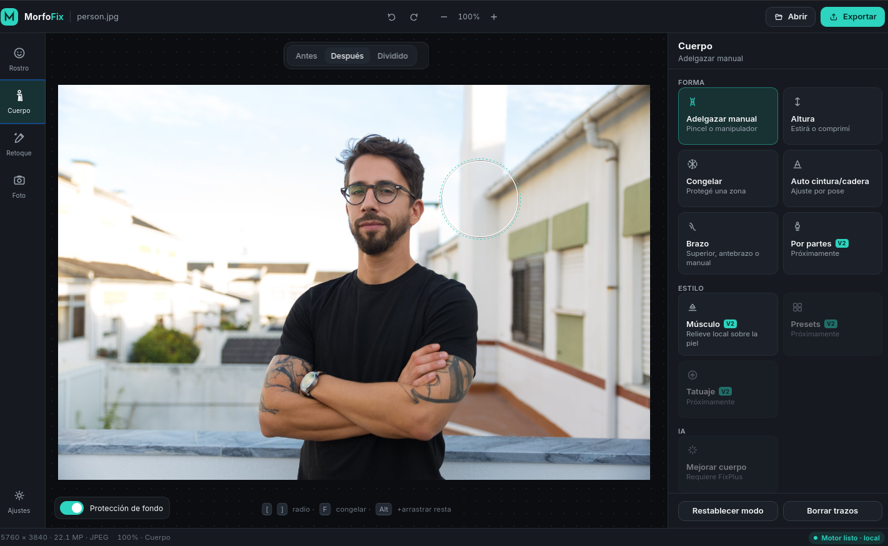

# MorfoFix

MorfoFix - Editor de Rostro y Cuerpo local, mejora tu cuerpo en las imágenes.
<a href="https://github.com/Eduardx-2/MorfoFix/blob/main/rusting/icons/icon.png"></a>

```
            ┌──────────── engine (Python 3.12, FastAPI, 127.0.0.1) ─────────────┐
 imagen ──► │ io.load (EXIF) ─► Session(original, preview, caches)              │
            │                        │                                          │
            │  (1) inference/  face.py  pose.py  segment.py  [parsing.py F4]    │
            │        └─► cache por (hash imagen, modelo, versión)               │
            │                        │ landmarks / keypoints / máscaras         │
            │  (2) params → campos de desplazamiento + capas de color           │
            │        face/reshape.py  body/slim.py  body/height.py              │
            │        warps/mesh.py (liquify 126²)  warps/mls.py  warps/field.py │
            │        retouch/skin.py teeth.py eyes.py inpaint.py                │
            │                        │                                          │
            │  (3) render/pipeline.py: compone UN solo remap + blends           │
            │        └─► preview JPEG (≤1600 px)  |  export full-res            │
            └───────────────────────────────────────────────────────────────────┘
```

## Cuerpo
<a href="https://github.com/Eduardx-2/MorfoFix/blob/main/mofixPy/docs/morfoCuerpo.png"></a>
¿Por qué MorfoFix?
- Editor de Rostro y Cuerpo.
- MorfoFix es 100% Local, sus fotos no se cargan a ningún servidor externo.
- Sin anuncios.
- No tiene marca de agua.
